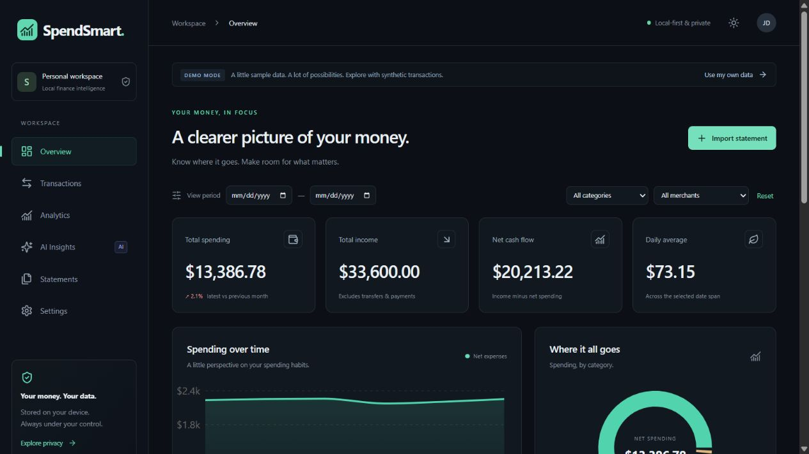
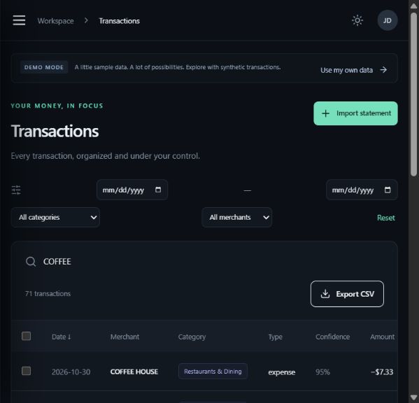
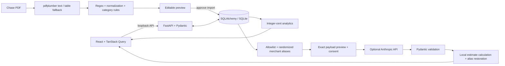

# SpendSmart

[](https://github.com/vrindha-k/SpendSmart/actions/workflows/ci.yml)

### A clearer picture of your money.

A local-first finance workbench built with **React + TypeScript and Python + FastAPI**. Turn supported Chase statement PDFs into searchable transactions, interactive analytics, and optional, consent-based Claude savings suggestions.

**No cloud deployment. No bank connection. No API key required to explore.**



> A single-user portfolio application for a trusted computer. Every screenshot and demo record is synthetic. This is an analytics tool, not financial advice or a banking service.

## Explore

| Area | Working functionality |
| --- | --- |
| Overview | Calculated spending, income, cash flow, daily average, monthly change, category donut, spending trend, recent activity, income/expense bars |
| Transactions | Search, date/category/merchant filters, sorting, pagination, persistent edits, bulk categories, confidence indicators, filtered CSV export |
| Analytics | Monthly cash flow, category breakdown, merchant comparison, ISO-week spending |
| Statements | Multiple PDF upload/drop, year selection, editable preview, row removal, approval, repeat-import deduplication |
| AI Insights | Local recurring-payment observations and category/month comparisons; optional Claude recommendations ranked by locally calculated estimated savings |
| Settings | Dark/light themes, persistent merchant rules, privacy information, dataset deletion |

Demo mode seeds **198 deterministic synthetic transactions across May–October 2026**. Switch between demo and imported records using the banner. Dataset scopes keep their analytics separate. Demo records regenerate at backend startup if the demo dataset is empty.



## Run on Windows in VS Code

Install **Python 3.12+**, **Node.js 24 LTS**, **Git**, and **VS Code**. Select Python's “Add python.exe to PATH” installer option. Open the `SpendSmart` folder in VS Code. Open two PowerShell terminals using **Terminal → New Terminal**.

```powershell
git clone https://github.com/vrindha-k/SpendSmart.git
cd SpendSmart
code .
```

### Terminal 1 — backend

From the repository root:

```powershell
cd backend
py -3.12 -m venv .venv
.\.venv\Scripts\python.exe -m pip install -r requirements.lock.txt
Copy-Item .env.example .env
.\.venv\Scripts\python.exe -m uvicorn app.main:app --host 127.0.0.1 --port 8000 --no-access-log
```

No environment activation or PowerShell execution-policy change is required. SQLite tables and synthetic demo data initialize automatically. Keep this terminal running. API docs: [http://127.0.0.1:8000/docs](http://127.0.0.1:8000/docs).

### Terminal 2 — frontend

From the repository root:

```powershell
cd frontend
npm.cmd ci
npm.cmd start
```

Open [http://127.0.0.1:5173](http://127.0.0.1:5173). `start` builds and serves React through Vite preview, proxying `/api` to FastAPI. This is a local demonstration server. Stop processes with `Ctrl+C`.

For development with hot reload, use `npm.cmd run dev`. Restricted Windows agent sandboxes can block esbuild's parent-directory inspection; `npm.cmd start` avoids that optimizer path. Build/tests use Node's native Vite config loader and require Node 24.

### Import a synthetic PDF

From `backend`, in another terminal:

```powershell
.\.venv\Scripts\python.exe scripts\generate_sample.py
```

This creates `backend/data/synthetic-chase.pdf` locally, ignored by Git. In **Statements**, choose ending year **2026**, upload it, review/correct the preview, and select **Approve & import**. The app switches to local records. Import it again to see duplicates skipped. Raw PDFs are discarded after extraction.

### Optional Claude

Edit only **`backend/.env`** locally:

```dotenv
ANTHROPIC_API_KEY=your_key_here
AI_ENABLED=true
CLAUDE_MODEL=claude-sonnet-5-5
```

Choose a model available to your account; consult [Anthropic's model reference](https://platform.claude.com/docs/en/models/overview). Restart FastAPI after changing configuration. Never put a key in frontend variables, source code, screenshots, issues, or chat messages.

In **AI Insights**, select **Review data to send**, inspect the exact JSON, check consent, and submit. The preview is single-use and expires after five minutes. No automatic external request occurs. If Claude is disabled, unavailable, or returns invalid JSON, a safe error appears and local analytics remain usable. API usage may incur charges on your account.

## Architecture



```text
SpendSmart/
├── frontend/src/
│   ├── pages/            # Routed product areas and empty state
│   ├── components/ui/   # shadcn-style Radix Slot / CVA Button
│   ├── charts.tsx       # Shared Recharts visualizations
│   ├── api.ts           # Typed HTTP boundary and shared types
│   ├── query.ts         # TanStack Query cache
│   └── main.tsx         # Layout, navigation, dataset scope, filters
├── backend/
│   ├── app/main.py      # FastAPI lifecycle and CORS
│   ├── app/routes.py    # Validated API handlers
│   ├── app/database.py  # ORM, sessions, initial schema migration
│   ├── app/parsing.py   # Regex extraction, normalization, 13 categories
│   ├── app/analytics.py # Cash flow, categories, trends, recurring detection
│   ├── app/privacy.py   # Allowlist, aliases, response schema, grounding
│   ├── app/demo.py      # Reproducible synthetic generator
│   ├── scripts/         # Synthetic PDF generator
│   └── tests/           # Unit and in-memory API/PDF integration tests
├── docs/                # Actual screenshots and engineering notes
├── .github/workflows/ci.yml
├── .env.example
└── .gitignore
```

**Frontend:** React 19, TypeScript, Vite, Tailwind CSS 4, shadcn-style Radix/CVA primitive, Framer Motion, Recharts, Lucide, TanStack Query, React Router. Fonts use the local system stack, preferring Inter when installed; no remote font request is made.

**Backend:** Python 3.12, FastAPI, Pydantic, SQLAlchemy, SQLite, pdfplumber, custom regex, Anthropic SDK. `requirements.txt` declares dependencies; `requirements.lock.txt` pins the tested environment. npm has a committed lockfile.

## Correct financial calculations

- Amounts are positive **integer cents**, with a separate transaction type. Stored money and parsed decimal conversion avoid binary floating point.
- Net spending = expenses − refunds. Income excludes transfers and card payments. Net cash flow = income − net spending. Card payments do not count as new purchases.
- Daily average uses the inclusive span between the first and last matching transaction. Monthly change compares the last two observed calendar months; partial months are not normalized.
- Merchant rules match normalized substrings. Custom rules win for future imports. Manual corrections set confidence to 100 and are never overwritten by a background classifier. Confidence is rule strength, not a calibrated probability.
- Duplicate fingerprints include date, normalized merchant, cents, type, and occurrence count, scoped by dataset. Two identical purchases in one preview are preserved; reimporting that preview skips both.
- Recurring detection requires at least three distinct months and amounts within $1. It is a heuristic, not confirmation of a subscription.
- Claude selects aliases and proposed percentage reductions. The server validates percentages, ignores unknown/duplicate aliases, excludes essential categories, subtracts refunds, and calculates estimates locally. Estimates are clearly labeled.

## Privacy and security

PDFs are limited to 10 MB and 50 pages, parsed in memory, and discarded. Multipart upload handling may use OS-managed temporary buffering. Pydantic validates input. SQLAlchemy parameterizes queries. Local servers bind to `127.0.0.1`; CORS permits the documented local frontend origins. The backend run command disables access logging.

The AI boundary uses an **allowlist**, rather than assuming regex scrubbed every possible secret. Its only outbound fields are random merchant alias, calendar month, integer cents, category, and transaction type. No raw description, exact date, PDF, filename, account/card number, address, customer name, or API key is included. Alias maps stay in server memory and restore merchant-specific recommendations locally.

**Minimized is not anonymous:** amounts, categories, months, and spending patterns can remain identifying. Provider retention and terms apply after consent. SQLite is unencrypted; local-first does not automatically mean secure. There is no multi-user authentication. Keep the server on loopback. Deleting rows does not securely erase disk blocks, backups, or browser CSV downloads.

`.gitignore` excludes secrets, databases/journals, financial PDFs/CSVs/spreadsheets, uploads, dependencies, and caches. Never force-add financial files. Only synthetic generators and screenshots belong in this repository.

## Testing and CI

```powershell
# From backend
.\.venv\Scripts\python.exe -m pytest -q

# From frontend
npm.cmd test
npm.cmd run build
```

Verified locally: **17 backend tests, 5 frontend tests, strict TypeScript checks, and the Vite production build pass**. The first GitHub Actions run also passed both jobs.

GitHub Actions runs separate Python 3.12 and Node 24 jobs for pushes and pull requests. Tests use in-memory SQLite, generated synthetic PDFs, and mocked Claude responses. CI requires neither API keys nor personal documents.

See [engineering notes](docs/ENGINEERING.md) for test coverage, API routes, tradeoffs, and an interview walkthrough.

## Limitations and next steps

The parser supports text layouts with dated transaction rows and recognizable section headers. Arbitrary Chase layouts, scanned PDFs, multiline descriptions, split amount columns, foreign currencies, and statement balance reconciliation need additional work. Verify every preview. Unsupported extraction fails without inventing records. Overlapping statements and corrected rows can make duplicate identity ambiguous. Original statement file history is not retained.

Claude is implemented and tested with mocked SDK responses; a live provider request needs your key and has not been verified in this build. Categories use local rules; Claude assists savings analysis rather than applying categories. There is a versioned initial schema bootstrap, not a complete historical migration chain. Encryption, authentication, OCR, process-isolated PDF parsing, and cloud deployment are outside this build.

Future improvements: a larger synthetic parser corpus with reconciliation; Alembic migrations; encrypted storage; accessible modal focus trapping; richer category-over-time comparisons; consented AI classification suggestions; deeper browser regression tests.

## License

[MIT](LICENSE)
